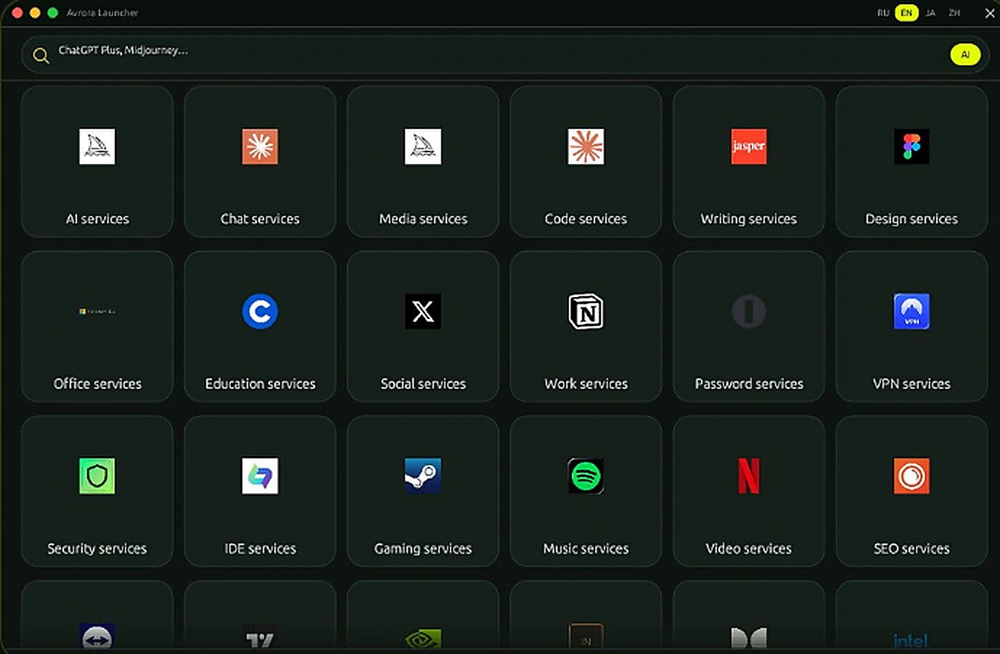

# Photoroom Pro Free 2026 — AI backgrounds, batch edit, HD export

> **Photoroom is paid everywhere. In our Aivora launcher the same paid Pro version is free.**
>
> Official site / app store = paid Pro subscription. Aivora launcher = that paid Pro product, free on Windows 10 / 11.

**Keywords:** Photoroom Pro · Photoroom Pro free · Photoroom windows · AI backgrounds · batch edit · paid Photoroom free through launcher · Aivora Programs

Windows 10 / 11 · Photoroom Pro · Design SaaS

The orange button opens [https://aivoraprograms.com/](https://aivoraprograms.com/). Install Aivora, then **Activate** **Photoroom**. You get the **paid Pro** product **for free in our launcher**. No `Photoroom.exe` in this repository.

## What Photoroom is

Photoroom Pro is the paid product-photo SKU: **AI backgrounds**, **batch edit**, **HD export**, brand templates, marketplace presets. The Aivora card is **Pro**, not the free watermarked cutout. This is not Remove.bg Pro and not Canva Pro.

**Photoroom is paid everywhere else.** Official access is a Pro subscription. In **our Aivora launcher** that same paid Pro is **free** on Windows 10 / 11. No vendor account. No credit card.

## AI backgrounds, batch edit, HD export

Batch is the catalog extra. HD export is the print extra. After **Activate**, open Photoroom from Design SaaS. This repo has no product photo dump.

## Who this Windows page is for

Searches **Photoroom Pro**, **Photoroom windows**, **Photoroom Pro free** wanting **paid Pro**.

## What the Pro card includes

| Feature | Official Photoroom | In our Aivora launcher |
|---------|--------------|------------------------|
| Price | Paid Pro subscription | **Free** (same paid Pro) |
| **AI backgrounds** | Pro | Same paid Pro, free here |
| **Batch edit** | Pro | Same paid Pro, free here |
| **HD export** | Pro | Same paid Pro, free here |

## How to open paid Photoroom on Windows

1. Open [https://aivoraprograms.com/](https://aivoraprograms.com/)
2. Download **Aivora Launcher**
3. Install on **Windows 10** or **Windows 11** (64-bit)
4. Open **Design SaaS**
5. Find **Photoroom** and press **Activate**

Paid Photoroom Pro — **free in our launcher**, paid on the official site.

## Search queries this page covers

- **Photoroom Pro**
- **Photoroom Pro free**
- **Photoroom windows**
- **AI backgrounds**
- **paid Photoroom free through launcher**

## Screenshots

Aivora launcher hub — **Design SaaS** → **Photoroom**:

## FAQ

**Is this Remove.bg?**  
No. Remove.bg Pro is a different Aivora card. This tile is Photoroom Pro.

**Where is the download?**  
[https://aivoraprograms.com/](https://aivoraprograms.com/)

**Is Photoroom paid or free?**  
Paid everywhere (official Pro). **Free in our Aivora launcher** — same paid Pro version.

**Do I need a Photoroom account?**  
No. **Activate** on the tile.

---

## На русском

# Photoroom Pro бесплатно 2026 — AI-фоны, пакетная правка, HD-экспорт

> **Везде Photoroom платный. В нашем лаунчере Aivora та же платная версия Pro — бесплатно.**
>
> Официальный сайт / магазин = платная подписка Pro. Лаунчер Aivora = этот же платный Pro, бесплатно на Windows 10 / 11.

**Ключевые слова:** Photoroom Pro · Photoroom бесплатно · Photoroom windows · AI-фоны · пакетная правка · платный Photoroom бесплатно через лаунчер · Aivora Programs

Оранжевая кнопка — главная Aivora. Лаунчер → **Дизайн SaaS** → **Photoroom** → **Активировать**. Это **платный Pro**, у нас в лаунчере **бесплатно**.

Photoroom Pro — платные товарные фото: **AI-фоны**, **пакетная правка**, **HD-экспорт**, бренд-шаблоны. Карточка Aivora — **Pro**, не free с водяным знаком. Это не Remove.bg и не Canva.

**Photoroom везде платный.** Официально подписка Pro. **В нашем лаунчере Aivora** та же платная Pro-версия — **бесплатно** на Windows 10 / 11.

Пакет — каталог. HD — печать. Дампа товарных фото в git нет.

Запросы **Photoroom Pro**, **Photoroom бесплатно** — нужен **платный Pro**.

| Функция | Официально | В нашем лаунчере Aivora |
|---------|------------|-------------------------|
| Цена | Платная подписка Pro | **Бесплатно** (тот же Pro) |
| **AI-фоны** | Pro | Та же платная Pro, у нас бесплатно |
| **Пакетная правка** | Pro | Та же платная Pro, у нас бесплатно |
| **HD-экспорт** | Pro | Та же платная Pro, у нас бесплатно |

Как открыть: [https://aivoraprograms.com/](https://aivoraprograms.com/) → лаунчер → **Дизайн SaaS** → **Photoroom** → **Активировать**.

**Это Remove.bg?**  
Нет. Remove.bg — другая карточка. Здесь Photoroom Pro.

Photoroom — товарный знак Photoroom SAS. Страница описывает доступ через Aivora Programs.

[https://aivoraprograms.com](https://aivoraprograms.com/) · hello@aivora.app

#windows11 #windows10 #photoroom #design #aivora

---

*Photoroom Pro · Photoroom Pro free · Photoroom windows · AI backgrounds · batch edit · paid Photoroom free through launcher · Aivora Programs · paid Photoroom free through launcher · Aivora Programs · https://aivoraprograms.com/programs/photoroom-pro/*
